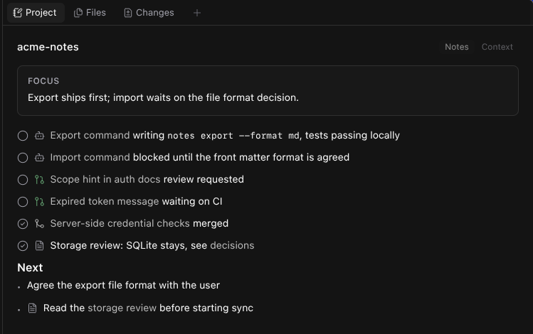

# Project manager for Paseo

A Paseo plugin that turns a chat into a Project coordinator. The coordinator keeps shared notes outside the repository, briefs the worker agents it starts, and follows their pull requests. A Project panel shows the notes, the store and its history.



See [OVERVIEW.md](OVERVIEW.md) for what it does, the data it touches and its limits.

## Install

Requires Paseo 0.12.0 or later, with `git` on the daemon machine and `gh` for pull request features.

```bash
paseo plugin install github:wy3z/paseo-projectmanager
```

Then run `/projectmanager` in a chat to make it the coordinator for that workspace. `/projectmanager off` stops briefing new agents and keeps the store.

## Develop

```bash
npm install
npm run typecheck
paseo plugin install /absolute/path/to/paseo-projectmanager
paseo plugin reload paseo-projectmanager
```

## Licence

MIT
